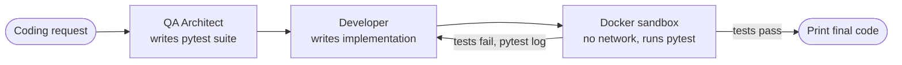

# Code-Twin

**An autonomous test-driven development loop: two local LLM agents, one writing tests and one writing code, with every attempt executed in a throwaway Docker sandbox.**

Code-Twin takes a plain-English coding request and has a *QA Architect* agent write a pytest suite for it **before** any implementation exists. A *Developer* agent then writes code to pass that suite. Each candidate runs inside a fresh, network-disabled container, and the real pytest output is fed back to the Developer until the tests pass or the retry budget runs out.

LLM-generated code often looks right but breaks on edge cases. Writing adversarial tests first turns "looks right" into "passes tests". Isolated execution keeps untrusted generated code off the host. Both agents run against a local [Ollama](https://ollama.com) model, so prompts and code never leave your machine and no API key is needed.

## How it works



1. **QA Architect** (`src/agents/qa_agent.py`) gets the request and returns a pytest suite: happy path, edge cases (zero, negative, `None`) and type errors. The tests import the function under test from a module called `main`.
2. **Developer** (`src/agents/dev_agent.py`) gets the request and the test suite and returns only the implementation. On a retry it also gets the previous failure log.
3. `main.py` strips any Markdown code fences the model adds to its output.
4. **Sandbox executor** (`src/utils/executor.py`):
   - builds the `code-twin-sandbox` image from the `Dockerfile` (cached after the first build)
   - starts a container with `network_disabled=True`
   - streams the candidate code (`main.py`) and the tests (`test_generated.py`) into `/app` as an in-memory tar archive
   - runs `pytest test_generated.py`
   - returns the exit code and output, then stops and removes the container, even on error
5. **Feedback loop**: the agents get up to 3 trials. When a trial fails, the full pytest output goes back to the Developer for a fix. When one passes, the final code is printed.

## Features

- **Tests-first, multi-agent workflow**: separate prompts and roles for the test writer and the implementer, so the code is checked against an independent spec.
- **Self-correction from real execution**: retries are driven by actual pytest failures, not by the model judging its own output.
- **Sandboxed execution**: one container per trial, with no network and automatic cleanup. Generated code never runs on the host.
- **Fully local and private**: uses Ollama's OpenAI-compatible API with `qwen2.5-coder:32b`. No cloud calls and no secrets.
- **Small and readable**: about 200 lines of Python in four modules, built on the official `openai` and `docker` SDKs.

## Tech stack

| Layer | Technology |
| --- | --- |
| Language | Python 3.10+ |
| LLM serving | Ollama (OpenAI-compatible endpoint), Qwen2.5-Coder 32B |
| LLM client | `openai` Python SDK |
| Sandbox | Docker, Docker SDK for Python (`docker`), `python:3.10-slim` image |
| Testing | pytest (inside the sandbox) |

## Prerequisites

- Python 3.10 or newer
- Docker Desktop or Docker Engine, running, and reachable by your user
- Ollama with the model pulled. `qwen2.5-coder:32b` is about a 20 GB download and needs a machine with roughly 24 GB+ of RAM or VRAM. See [Configuration](#configuration) to use a smaller model.

## Run locally

```bash
git clone https://github.com/yashsinha1702/code-twin.git
cd code-twin

python -m venv .venv && source .venv/bin/activate
pip install -r requirements.txt

# LLM: make sure the Ollama server is running (`ollama serve` or the desktop app)
ollama pull qwen2.5-coder:32b

python main.py
```

Run `main.py` from the repository root, because the executor builds the sandbox image from the `Dockerfile` in the current directory. A session looks like this:

```text
🚀 Code-Twin: Autonomous TDD Agent (32B Model Loaded)

Enter your coding request: Write a function is_palindrome(s) that ignores case and non-alphanumeric characters

1. 🕵️  QA Architect is designing tests...
2. 👨‍💻 Developer is building the first draft...

3. ⚖️  Running Trial 1...
```

If a trial passes, Code-Twin prints `✅ SUCCESS on attempt N!` followed by the final code. If it fails, it shows the first 300 characters of the pytest output, the Developer revises the code, and the next trial runs.

## Docker

Docker is the **sandbox**, not the deployment target. The `Dockerfile` defines the image that the generated code and tests run in:

```dockerfile
FROM python:3.10-slim
WORKDIR /app
RUN pip install pytest
# no application code is copied: the executor streams files in at runtime
```

The executor builds and tags this image (`code-twin-sandbox`) at the start of every trial, and Docker's layer cache makes that fast after the first build. To build it ahead of time:

```bash
docker build -t code-twin-sandbox .
```

The agent loop itself runs on the host because it needs both the Docker daemon and the Ollama server. Running Code-Twin inside a container would require mounting the Docker socket, and that setup isn't provided.

## Configuration

Code-Twin **reads no environment variables and needs no secrets.** Ollama's OpenAI-compatible endpoint ignores the API key, so the client passes the placeholder `"ollama"`. All settings are constants in the source:

| Setting | Location | Default |
| --- | --- | --- |
| LLM endpoint | `base_url` in `src/agents/qa_agent.py` and `src/agents/dev_agent.py` | `http://localhost:11434/v1` |
| Model | `model=` in both agent files | `qwen2.5-coder:32b` |
| Sampling temperature | `temperature=` in both agent files | `0.2` |
| Trials per request | `max_retries` in `main.py` | `3` |
| Sandbox image | `Dockerfile`, tag `code-twin-sandbox` in `src/utils/executor.py` | `python:3.10-slim` + pytest |

To use a smaller model (for example `qwen2.5-coder:7b`), pull it with Ollama and change `model=` in both agent files. The Docker connection is created with `docker.from_env()`, so the standard Docker environment variables (`DOCKER_HOST`, `DOCKER_TLS_VERIFY`, `DOCKER_CERT_PATH`) work for remote or rootless daemons without code changes.

## Project structure

```text
code-twin/
├── main.py                 # CLI entry point: QA -> Developer -> sandbox feedback loop
├── Dockerfile              # Sandbox image (python:3.10-slim + pytest)
├── requirements.txt        # Host dependencies: openai, docker
└── src/
    ├── agents/
    │   ├── qa_agent.py     # QA Architect: generates the pytest suite
    │   └── dev_agent.py    # Developer: writes and repairs the implementation
    └── utils/
        ├── executor.py     # Docker sandbox runner (tar -> put_archive -> pytest)
        └── executor_old.py # Earlier subprocess-based runner (no isolation), not used
```

## Limitations and next steps

- **No execution timeout in the sandbox.** Generated code with an infinite loop hangs the trial. The earlier subprocess runner had a 10-second timeout, and the next step is to add one to `exec_run`, along with CPU and memory limits on the container.
- **Single-module scope.** Tests import from one `main` module, so multi-file projects are out of scope.
- **Tests are trusted as written.** If the QA agent writes a wrong test, the Developer can't fix it, because only the implementation is regenerated. A test-review step, or letting the Developer flag a bad test, would close this gap.
- **Hard-coded model settings.** Moving the endpoint and model into environment variables would make it easier to switch models.

## License

[MIT](LICENSE) © 2026 Yash Sinha
